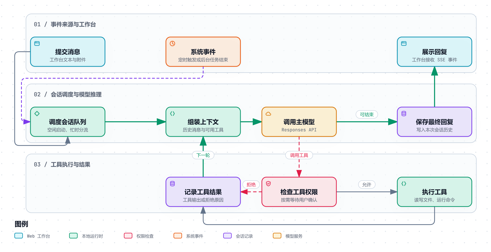

<h1> Raccoon-Agent</h1>

Raccoon-Agent 是一个在本地工作区运行的事件驱动型异步 Agent。用户发来消息、定时器到期、后台任务返回结果，都可以触发它继续工作。

Raccoon 正在处理任务时，工作台里新发来的消息默认排队。[启用消息路由](#辅助模型)后，Raccoon 可以把补充要求接到当前任务中，按紧急指令中断当前任务，或并行回答独立的简单问题。其余消息继续排队。后台工具完成后，结果也会作为新事件回到会话，供 Raccoon 决定下一步。

## 整体架构与运行流程



## 技术文档

下表对应上方流程图的三个分区。各篇将结合流程图介绍关键对象、函数及设计取舍，目前正文待补。

<table>
  <thead>
    <tr><th>模块</th><th>主题</th><th>文档</th></tr>
  </thead>
  <tbody>
    <tr>
      <td rowspan="4"><strong>事件来源与工作台</strong></td>
      <td>工作台消息、附件</td>
      <td><a href="docs/01-messages.md">Messages</a></td>
    </tr>
    <tr>
      <td>定时任务、到期事件</td>
      <td><a href="docs/02-scheduling.md">Scheduling</a></td>
    </tr>
    <tr>
      <td>后台任务、完成通知</td>
      <td><a href="docs/03-background-tasks.md">Background Tasks</a></td>
    </tr>
    <tr>
      <td>SSE 事件流、任务进度、回复展示</td>
      <td><a href="docs/04-event-stream.md">Event Stream</a></td>
    </tr>
    <tr>
      <td rowspan="5"><strong>会话调度与模型推理</strong></td>
      <td>消息排队、任务追加指令、任务中断、并行答复</td>
      <td><a href="docs/05-routing.md">Routing</a></td>
    </tr>
    <tr>
      <td>Agent 主循环、结束条件</td>
      <td><a href="docs/06-agent-loop.md">Agent Loop</a></td>
    </tr>
    <tr>
      <td>上下文组装、Token 预算、历史摘要</td>
      <td><a href="docs/07-context.md">Context</a></td>
    </tr>
    <tr>
      <td>Responses API 请求、响应解析</td>
      <td><a href="docs/08-responses-api.md">Responses API</a></td>
    </tr>
    <tr>
      <td>会话历史存取</td>
      <td><a href="docs/09-session-history.md">Session History</a></td>
    </tr>
    <tr>
      <td rowspan="3"><strong>工具执行与结果</strong></td>
      <td>工具注册、参数定义</td>
      <td><a href="docs/10-tool-registry.md">Tool Registry</a></td>
    </tr>
    <tr>
      <td>工具权限、自动审核、用户确认</td>
      <td><a href="docs/11-permissions.md">Permissions</a></td>
    </tr>
    <tr>
      <td>工具执行、结果回写</td>
      <td><a href="docs/12-tool-execution.md">Tool Execution</a></td>
    </tr>
  </tbody>
</table>

## 一句话交给 AI 助手安装

把下面这段话发给能操作本地终端的 AI 助手即可。

```text
请帮我安装 Raccoon-Agent。优先使用本地已有的仓库，如果还没有，就克隆 https://github.com/Zyrong94/Raccoon-Agent.git 。按仓库 README 的「快速开始」准备本地环境，保留已有配置。完成后告诉我从哪个目录启动、运行哪条命令，以及还需要我在本机填写哪些模型信息或密钥。
```

## 快速开始

下载或克隆源码，安装 Python 3.11+ 和 Node.js 20.9+（含 npm），然后按以下步骤配置模型并启动工作台。

### 配置主模型

主模型配置默认保存在用户目录下的 `.config/raccoon/models.toml`。Windows 用户可在资源管理器的地址栏输入 `%USERPROFILE%\.config\raccoon` 前往配置目录。首次使用时按需创建目录和文件。将下面两处 `YOUR_MODEL_ID` 换成实际模型 ID，`base_url` 填写支持 OpenAI Responses API 的服务地址。

```toml
default_model = "custom/YOUR_MODEL_ID"

[providers.custom]
base_url = "https://api.openai.com/v1"
api_key_env = "RACCOON_API_KEY"

[models."custom/YOUR_MODEL_ID"]
```

在仓库根目录将 [.env.example](.env.example) 复制为 `.env`，填入主模型密钥 `RACCOON_API_KEY`。已有 `.env` 时，直接在原文件中填写即可。

### 辅助模型

要使用以下三项功能，请在 `.env` 中分别填齐对应组的服务地址、模型 ID 和密钥。每项功能只使用为它配置的模型。

- **消息路由**在会话忙碌时判断如何处理新消息。缺少路由模型时，新消息默认排队。
- **权限审核**在自动审核模式下评估工具操作。未配置审核模型时，需要审核的操作会交给用户确认。
- **上下文摘要**将长对话中较早的内容压缩成摘要。缺少摘要模型时会跳过自动摘要，手动压缩或上下文溢出时若需要生成摘要则会报错。

### 启动工作台

在仓库根目录执行以下命令。

```powershell
python start.py
```

首次启动会自动安装依赖。工作台就绪后，浏览器会打开 <http://127.0.0.1:3000>。按 `Ctrl+C` 停止服务。

文件操作和命令执行都在本机完成。模型请求会把相关代码、对话和工具输出发送给所配置的服务。
