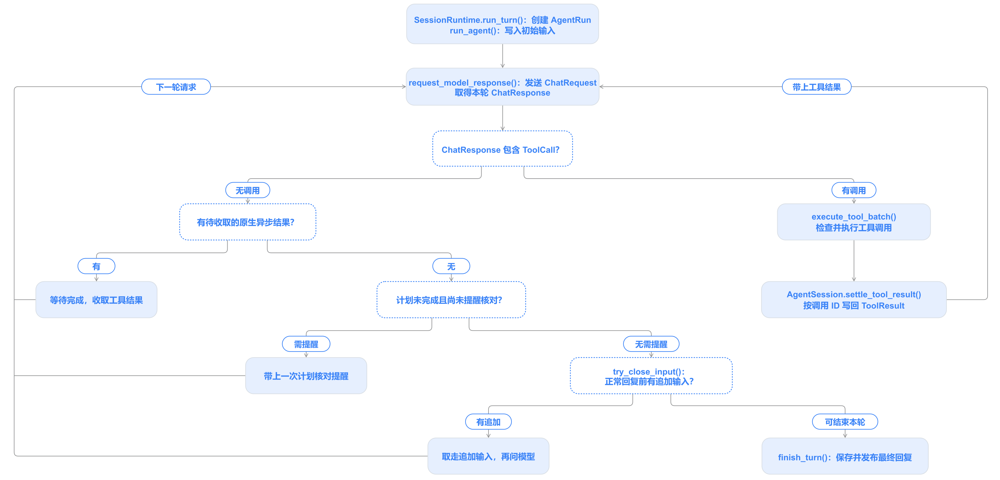

# Agent 主循环与结束条件

用户在工作台问「这个项目怎么启动」，会话调度器为这条消息启动了一次运行。假设模型需要先查看项目的 README，它会在第一轮响应里请求读取文件。Agent 主循环执行这个工具，把读到的内容带进下一轮模型请求。模型随后可以给出启动命令，也可以继续请求查看配置文件。等模型给出回答，主循环还要检查有没有待处理的工具结果、未完成的计划，或用户刚追加的消息。都处理完后，这次运行才保存最终回复。

## 对象与字段

| 对象 | 关键字段与类型 | 在这次运行中的作用 |
| --- | --- | --- |
| `SessionRuntime` | `session: AgentSession`，`active_run: AgentRun` &#124; `None` | 接收调度器交来的输入，创建当前运行。 |
| `AgentSession` | `data: SessionData`，`store: SessionStore`，`tool_registry: ToolRegistry` | 持有会话历史、存储入口和可执行工具。同一会话的多次运行共享这些数据和依赖。 |
| `AgentRun` | `session: AgentSession`，`provider: ChatProvider`，`cancellation_token: CancellationToken` &#124; `None` | 组织本次提问的模型请求和工具执行，并在执行期间检查用户是否要求停止。 |
| `ChatRequest` | `messages: list[ChatMessage]`，`tools: list[ToolDefinition]` | 一轮模型请求。第二次请求的消息中包含工具读出的 README 内容。 |
| `ChatResponse` | `content: str`，`tool_calls: list[ToolCall]`，`finish_reason: FinishReason` &#124; `None` | 一轮模型响应。主循环先看 `tool_calls`，决定是否进入工具执行分支。 |
| `ToolCall` | `id: str`，`name: str`，`arguments: dict[str, Any]` &#124; `str` | 描述模型要调用的工具和参数，例如要读哪个文件。`id` 标识这一次调用。 |
| `ToolResult` | `ok: bool`，`content: str`，`error: str` &#124; `None` | 带回文件内容或失败原因。保存时用原 `ToolCall.id` 将结果与调用对应起来。 |

## 关键函数

| 函数 | 何时调用，做什么 |
| --- | --- |
| [SessionRuntime.run_turn()](../raccoon/app/session_runtime.py#L209) | 调度器交来输入后，通过 `create_run()` 创建 `AgentRun`，再进入主循环。 |
| [run_agent()](../raccoon/modules/agent/run.py#L949) | 写入初始输入并进入循环。模型请求工具时，先保存调用，再执行工具并进入下一轮。模型给出回答时，依次检查下文的三个结束条件。 |
| [AgentRun.request_model_response()](../raccoon/modules/agent/run.py#L228) | 每轮请求前收取追加输入，组装模型请求，等待并返回一个 `ChatResponse`。 |
| [execute_tool_batch()](../raccoon/modules/agent/tool_execution.py#L94) | 处理一次响应里的整批工具调用，检查参数和权限，随后执行工具或将其分派到后台。 |
| [AgentSession.settle_tool_result()](../raccoon/modules/agent/session.py#L75) | 把工具结果与原调用一起记入会话，下一轮模型请求就能带上读回的文件内容。 |
| [AgentRun.finish_turn()](../raccoon/modules/agent/run.py#L293) | 主循环决定结束后，保存最终响应并通知调用方。 |

## Agent 主循环流程图

当响应没有工具调用时，`run_agent()` 按顺序检查是否还需要再请求一轮模型。

1. **原生异步工具结果。** 如果本次运行仍有原生异步工具需要收尾，就等待并收取结果，带着结果再请求模型。
2. **未完成的计划。** 如果计划中还有未完成项，就提醒模型核对进度、继续工作或说明阻塞原因。每次运行最多发出一次这样的提醒。
3. **用户追加的消息。** 正常回复发布前，如果调度器提供了 `try_close_input()`，主循环会尝试关闭输入入口。有新消息就带入下一轮，成功关闭后才保存最终回复。

## 设计思路

1. **会话保存历史，每次提问单独运行。** 用户先问「项目怎么启动」，随后又问「Windows 上也一样吗」。两次提问可以共用 `AgentSession`，第二次仍能看到第一次读出的 README。每次运行各自创建 `AgentRun`，所以停止当前任务后，之前的对话和已经保存的工具结果仍然可用。

2. **让模型根据工具结果决定下一步。** 第一轮请求时，模型还没看到 README，也就无法判断还需不需要查看配置文件。`run_agent()` 执行工具后，把结果带进下一轮，请模型决定继续查文件还是回答用户。运行没有固定轮数上限，长任务可以继续完成；相应地，如果模型反复请求同一项操作，就可能需要用户手动停止。

3. **先记下工具调用，再按调用 ID 保存结果。** 假设模型同时要求读 `README.md` 和 `config.yaml`，主循环先记下两条 `ToolCall`。随后 README 读取成功，配置文件却返回「文件不存在」。两次用的是同一个读文件工具，单看工具名无法判断哪个文件没找到。`settle_tool_result()` 保存每条 `ToolResult` 时带上原调用的 `tool_call.id`，下一轮请求就能把内容和错误分别对应到正确的文件。

4. **用已保存的结果处理重复通知和中断。** 同一个调用的完成通知来了两次，第二次直接返回已有结果的消息 ID。反过来，如果用户点停止时 README 的结果已经保存，另一项普通工具调用却只有调用记录，主循环会保留 README 的结果，并给缺少结果的调用补记「已中断，执行结果未知」。恢复会话时，模型能看出哪些内容已经读到，哪些操作还无法确认。

5. **发布最终回复前，确认新到的信息已经处理。** 模型生成了一份启动说明时，用户可能刚补了一句「我用的是 Windows」。`try_close_input()` 在同一把锁里检查追加队列并决定能否关闭入口。有补充就再问模型，队列为空才关闭入口并保存回复。异步工具结果同样可能改变答案，需要带回模型；未完成的计划则最多提醒核对一次，让模型有机会继续工作或说明阻塞原因。

## 源码入口

- [会话状态](../raccoon/modules/agent/session.py)：同一段会话的多次运行共享一个 `AgentSession`，每次运行使用自己的 `AgentRun`。
- [运行入口](../raccoon/app/session_runtime.py)：`SessionRuntime.run_turn()` 创建一次 `AgentRun`。
- [主循环](../raccoon/modules/agent/run.py)：`run_agent()` 调用 `request_model_response()`。模型没有请求工具时，还要检查待收取的异步结果和未完成的计划。正常回复发布前还会调用 `try_close_input()`。追加列表非空时再请求一轮模型，入口关闭后才由 `finish_turn()` 保存最终响应。

[返回模块指南](../README.md#模块指南)
