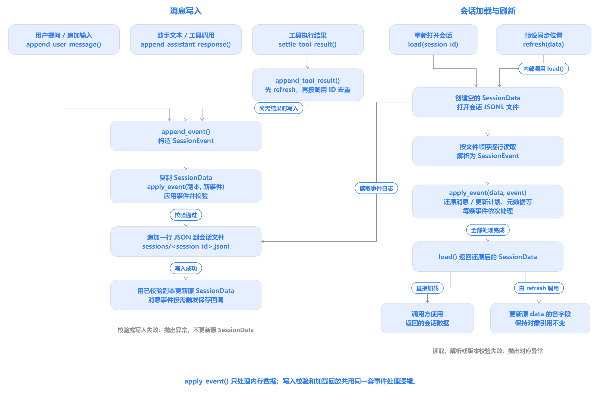

# 会话历史

用户问「这个项目怎么启动」，Agent 读取 README 后给出了启动说明。随后用户又问「Windows 上也一样吗」，这次运行需要用到前面的提问、已经读到的文件内容和助手回复。这些信息由会话历史保存：运行过程中，用户消息、工具调用、工具结果和助手回复陆续写入会话，并以事件的形式追加到本地 JSONL 文件中。重新加载会话时，`SessionStore` 按顺序读取这些事件，还原出 `SessionData`，让后续运行能够继续使用已有记录。

## 对象与字段

| 对象 | 关键字段与类型 | 在会话历史中的作用 |
| --- | --- | --- |
| `AgentSession` | `data: SessionData`<br>`store: SessionStore`<br>`tool_registry: ToolRegistry`<br>`permission_manager: PermissionManager` &#124; `None` | 持有会话数据、存储入口和执行依赖。保存历史时，把自己的 `data` 交给 `store`。工具注册表和权限管理器属于运行期依赖，不随消息写入历史。 |
| `SessionData` | `session_id: str`<br>`messages: list[AgentMessage]`<br>`compactions: list[CompactionRecord]`<br>`task_plan: TaskPlan` &#124; `None`<br>`tool_loads: list[dict[str, Any]]`<br>`metadata: dict[str, Any]` | 内存中的当前会话数据，保存消息、压缩记录、当前计划、已加载工具定义的记录和会话元数据。重新加载时，由事件日志还原。 |
| `AgentMessage` | `id: str`<br>`role: MessageRole` &#124; `str`<br>`parts: list[MessagePart]`<br>`metadata: dict[str, Any]` | 一条会话消息。`role` 标识消息角色，`parts` 保存具体内容；一次助手响应可以同时包含文本和多个工具调用。`metadata` 保存消息来源、模型和用量等信息。 |
| `MessagePart` | `id: str`<br>`message_id: str`<br>`kind: PartKind` &#124; `str`<br>`content: str`<br>`metadata: dict[str, Any]` | 消息中的一个内容单元，`message_id` 指向所属消息。`kind` 区分文本、工具调用、工具结果等；`content` 保存文本，`metadata` 保存调用 ID、工具参数或附件信息等。 |
| `SessionEvent` | `id: str`<br>`session_id: str`<br>`type: str`<br>`payload: dict[str, Any]`<br>`created_at: str` | JSONL 文件中每行保存的一条事件。`type` 表示发生了什么，`payload` 保存具体数据。消息事件可以还原成 `AgentMessage`，计划或元数据更新事件则修改对应字段。 |
| `SessionStore` | `root: Path`<br>`sessions_dir: Path`<br>`on_message_committed: Callable[[str, AgentMessage], None]` &#124; `None` | 负责事件写入和会话加载，自身没有 `SessionData` 字段。写入时接收要更新的数据，加载时返回还原后的数据。消息保存成功后，可通过回调通知调用方。 |

这些对象的包含关系如下：

```text
AgentSession
├── data: SessionData
│   ├── messages: list[AgentMessage]
│   │   └── parts: list[MessagePart]
│   ├── compactions: list[CompactionRecord]
│   ├── task_plan: TaskPlan | None
│   ├── tool_loads: list[dict[str, Any]]
│   └── metadata: dict[str, Any]
└── store: SessionStore
    └── 读写 sessions/<session_id>.jsonl
        每行保存一个 SessionEvent
```

`MessageRole` 定义了 `user`、`assistant`、`tool`、`system_meta`。`PartKind` 包含 `text`、`reasoning`、`tool_call`、`tool_result`、`image` 和 `file`。助手的正文、推理项和工具调用按 API 原顺序保存；推理部分不作为正文展示。

同一条消息可以包含多个部分。例如，助手先说「我先看一下 README」，随后请求读文件，这条助手消息就包含一个 `text` 部分和一个 `tool_call` 部分。

| `MessagePart.kind` | `content` 保存什么 | `metadata` 中的相关字段 |
| --- | --- | --- |
| `text` | 用户提问或助手回复的文本。 | 按来源附带的信息，也可以为空。 |
| `reasoning` | 空字符串，密文不进入正文。 | `reasoning_item` 保存完整 API 推理项，另有来源服务、模型和用量提示。 |
| `tool_call` | 当前实现为空字符串。 | `tool_call_id`、`tool_name`、`arguments` 等。 |
| `tool_result` | 工具返回的内容。 | `tool_call_id`、`tool_name`、`ok`、`error`、`data` 等。 |

## 关键函数

| 函数 | 何时调用，做什么 |
| --- | --- |
| [SessionStore.create()](../raccoon/modules/sessions/store.py#L118) | 创建会话时，初始化 `SessionData`，写入 `session_created` 事件，记录会话元数据和存储格式版本，返回这份会话数据。 |
| [SessionStore.append_user_message()](../raccoon/modules/sessions/store.py#L399) | 主循环接收初始输入或追加输入时，将文本和附件整理成消息部分，写入 `user_message` 事件。提供 `source_event_id` 时检查重复输入，避免同一条消息重复保存。 |
| [SessionStore.append_assistant_response()](../raccoon/modules/sessions/store.py#L484) | 保存模型请求的工具调用或最终回复时，将响应中的文本和工具调用转换为 `MessagePart`，写入 `assistant_message` 事件，同时记录模型和用量等信息。 |
| [AgentSession.settle_tool_result()](../raccoon/modules/agent/session.py#L75) | 工具结果收尾的入口。将自身的 `data`、原工具调用和执行结果交给 `store.append_tool_result()`；确实新增结果后，再保存待写入的工具定义并触发结果回调。 |
| [SessionStore.append_tool_result()](../raccoon/modules/sessions/store.py#L517) | 保存工具结果前，先刷新会话数据，再检查同一个 `tool_call_id` 是否已有结果。已有就返回原消息 ID，否则写入 `tool_result` 事件。 |
| [SessionStore.append_event()](../raccoon/modules/sessions/store.py#L135) | 各类事件写入的共同入口。先在会话数据副本上应用事件并校验，再追加到 JSONL 文件；写入成功后，更新原来的 `SessionData`。 |
| [SessionStore.load()](../raccoon/modules/sessions/store.py#L88) | 重新加载会话时，创建一份空的 `SessionData`，逐行读取事件并调用 `apply_event()`，返回还原后的数据。文件不存在、为空、记录损坏或版本不支持时抛出对应异常。 |
| [apply_event()](../raccoon/modules/sessions/store.py#L654) | 将一条事件应用到内存中的 `SessionData`。消息事件还原成消息并追加到 `messages`；计划、压缩或元数据事件更新对应字段。这个函数不读写文件，写入前校验和加载还原都会调用它。 |
| [SessionStore.refresh()](../raccoon/modules/sessions/store.py#L128) | 调用 `load()` 读取整个会话的最新记录，再更新原 `SessionData` 的字段，保持对象引用不变。程序在保存工具结果、读取当前计划等预设位置主动调用，不会先检查文件是否发生变化。 |

## 会话历史写入与恢复流程图



## 设计思路

1. **用事件记录保存过程，用会话数据支持当前运行。** 用户问「这个项目怎么启动」，Agent 读取 README 后给出启动说明，这些内容陆续以事件形式追加到 JSONL 文件中。同时，`SessionData` 在内存中保存当前的消息和其他会话数据，供运行期间使用。重新打开会话时，`load()` 按文件顺序读取事件，通过 `apply_event()` 还原数据。计划更新、压缩记录和会话元数据也沿用这条保存路径，但它们更新各自的字段，不一定产生新的对话消息。

2. **一条消息可以包含多种内容，工具调用和结果通过调用 ID 对应。** 模型可能在同一次响应中先说「我先查看 README 和配置文件」，再请求两次读文件。这条助手消息会包含一个文本部分和两个工具调用部分，各自保存为 `MessagePart`。工具执行完成后，结果作为单独的工具消息写入，通过 `tool_call_id` 对应原调用。即使两次调用使用同一个工具，也能区分哪个结果来自 README，哪个来自配置文件。

3. **先确认新记录能处理、能保存，再更新原来的内存数据。** 假设当前会话有 10 条消息，现在要保存第 11 条——README 的读取结果。`append_event()` 先复制当前 `SessionData`，在副本上调用 `apply_event()` 加入新结果，此时副本有 11 条消息，原数据仍然只有 10 条。随后将新事件写入 JSONL 文件，写入成功后才用副本中的字段更新原数据。如果处理事件或写入文件失败，就抛出异常，原数据保持不变，避免 Agent 提前使用一条尚未成功保存的记录。这里的校验是检查事件数据能否按程序规则应用到会话中，不是判断 README 内容是否正确。保存前处理新事件和加载时逐条还原事件，都调用同一个 `apply_event()`，因此不用分别维护两套事件处理逻辑。

4. **在可能遇到重复记录或旧数据的位置，先同步再检查。** 假设 README 的工具结果已经保存，同一次调用的完成通知又到达了一次。`append_tool_result()` 会先调用 `refresh()` 读取最新历史，再按 `tool_call_id` 查找已有结果；找到后直接返回原消息 ID，不再追加记录。用户输入则在提供 `source_event_id` 时按来源事件去重。刷新时更新原 `SessionData` 的字段，保留对象引用，让持有这份数据的其他代码也能看到更新。刷新时机由程序预先设置，每次都会重新读取并回放会话文件，因此实现直接，但会增加文件读取和回放开销。

## 源码入口

- [会话记录](../raccoon/modules/sessions/events.py)：`SessionEvent` 表示持久化的一条会话事件。
- [数据结构](../raccoon/modules/sessions/models.py)：`SessionData` 保存会话数据，`AgentMessage` 和 `MessagePart` 表示消息及其组成部分。
- [存取与回放](../raccoon/modules/sessions/store.py)：`SessionStore.append_event()` 追加事件，`load()` 和 `apply_event()` 从记录还原会话。

[返回模块指南](../README.md#模块指南)
