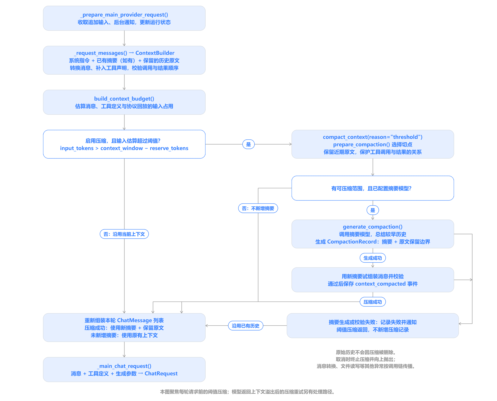

# 上下文组装与压缩

用户接着问「Windows 上也一样吗」，Agent 需要把这次提问和前面的对话一起交给模型。每轮请求前，程序从 `SessionData` 中取出会话历史，由 `ContextBuilder` 将用户消息、助手回复和工具结果转换成模型输入消息，再结合系统指令和可用工具定义组成请求。随着对话和文件读取结果不断增加，输入可能接近模型的上下文窗口上限。启用压缩且配置了摘要模型时，程序会尝试将较早的历史整理成摘要，保留近期消息原文，并确保工具调用与结果的对应关系不被切断。压缩记录会保存到会话中，原始历史仍然保留，后续请求使用摘要和保留的消息继续任务。

## 对象与字段

| 对象 | 关键字段与类型 | 在上下文组装与压缩中的作用 |
| --- | --- | --- |
| `AgentRun` | `session: AgentSession`<br>`context_builder: ContextBuilder`<br>`compaction_settings: CompactionSettings`<br>`context_window: int` &#124; `None`<br>`reasoning_effort: str` &#124; `None`<br>`auxiliary_models: AuxiliaryModels` | 组织每轮请求前的准备工作：读取会话数据、估算输入大小、按需压缩，再组装请求。`auxiliary_models.context_summary` 提供生成摘要所用的模型。 |
| `AgentSession` | `data: SessionData`<br>`store: SessionStore`<br>`prompt_builder: SystemPromptBuilder`<br>`prompt_cache: PromptPrefixCache` | 提供会话历史和压缩记录，构建并缓存系统指令，通过存储对象保存新生成的压缩记录。 |
| `SessionData` | `messages: list[AgentMessage]`<br>`compactions: list[CompactionRecord]`<br>`tool_loads: list[dict[str, Any]]` | 保存原始消息、历次压缩记录和工具定义加载记录。组装上下文时，使用最新压缩记录确定摘要内容和原文保留范围。 |
| `ContextBuilder` | 无实例字段；主要输入为 `view: SessionData`、`system_prefix: list[ChatMessage]` &#124; `None` | 将传入的会话数据转换为 `ChatMessage` 列表。自身不持有会话数据，也不调用模型生成摘要或写入文件。 |
| `ChatRequest` | `messages: list[ChatMessage]`<br>`tools: list[ToolDefinition]`<br>`tool_choice: ToolChoice` &#124; `None`<br>`reasoning_effort: str` &#124; `None` | 交给模型适配器的一轮请求，包含输入消息、工具定义和生成参数。`reasoning_effort` 是本轮使用的推理强度，未设置时使用服务默认值。 |
| `ChatMessage` | `role: MessageRole`<br>`content: str`<br>`content_parts: list[ContentPart]` &#124; `None`<br>`tool_calls: list[ToolCall]`<br>`tool_call_id: str` &#124; `None`<br>`additional_tools: list[ToolDefinition]`<br>`parts: list[MessagePart]` | 请求中的一条消息。可包含文本、附件、工具调用或工具结果，还可携带增量工具定义；助手输出通过有序 `parts` 保留正文、推理和调用的协议字段。 |
| `ContentPart` | `type: Literal["text", "image", "file"]`<br>`text: str` &#124; `None`<br>`media_type: str` &#124; `None`<br>`data_base64: str` &#124; `None`<br>`filename: str` &#124; `None`<br>`estimated_tokens: int` &#124; `None` | 请求消息中的文本、图片或文件内容。与保存历史的 `MessagePart` 不同，它用于模型请求中的多模态输入。 |
| `ContextBudget` | `context_window: int`<br>`output_reserve: int`<br>`input_capacity: int`<br>`fixed_tokens: int`<br>`history_tokens: int`<br>`input_tokens: int`<br>`source: Literal["configured", "assumed"]` | 保存本轮输入的预算估算：窗口大小、输出预留、输入容量，以及系统指令与工具定义、历史消息各自占用的估算值。`source` 表示窗口大小来自配置还是默认假设。 |
| `CompactionSettings` | `enabled: bool`<br>`reserve_tokens: int`<br>`keep_recent_tokens: int` | 控制是否启用压缩、距离窗口上限预留多少空间，以及选择压缩范围时近期原文的保留预算。当前默认值分别为 `True`、`32768`、`20000`。 |
| `CompactionPreparation` | `messages_to_summarize: list[AgentMessage]`<br>`turn_prefix_messages: list[AgentMessage]`<br>`first_kept_message_id: str`<br>`previous_summary: str` &#124; `None`<br>`tokens_before: int` | 生成摘要前准备好的材料。记录要总结的历史、切分发生在一次提问内部时需要单独总结的前半段、第一条保留原文的消息 ID，以及已有摘要。 |
| `CompactionRecord` | `id: str`<br>`session_id: str`<br>`created_at: str`<br>`summary: str`<br>`first_kept_message_id: str`<br>`reasoning_cutoff_message_id: str`<br>`tokens_before: int`<br>`usage: TokenUsage` &#124; `None` | 一次成功压缩后保存的记录。`summary` 代表较早历史，`first_kept_message_id` 标出从哪条消息开始继续保留原文，`usage` 记录摘要调用的用量。 |

这些对象的包含关系如下：

```text
AgentRun
├── session: AgentSession
│   ├── data: SessionData
│   │   ├── messages: list[AgentMessage]       原始历史
│   │   └── compactions: list[CompactionRecord]
│   ├── store: SessionStore
│   ├── prompt_builder: SystemPromptBuilder
│   └── prompt_cache: PromptPrefixCache
├── context_builder: ContextBuilder
└── compaction_settings: CompactionSettings

组装后得到 ChatRequest
├── messages: list[ChatMessage]
│   ├── content_parts: list[ContentPart] | None
│   ├── tool_calls: list[ToolCall]
│   └── additional_tools: list[ToolDefinition]
└── tools: list[ToolDefinition]
```

`AgentMessage` / `MessagePart` 表示保存的历史，`ChatMessage` / `ContentPart` 表示本轮准备发送的输入。`ContextBuilder` 负责两者之间的转换，具体 SDK 请求格式仍由模型适配器处理。

本地预算中的预留空间与 API 输出上限分开处理：

- `ContextBudget.output_reserve` 接收压缩设置中的本地预留预算，用于计算 `input_capacity = context_window - output_reserve`。
- `CompactionSettings.reserve_tokens` 用于自动压缩的阈值判断。当前代码检查的是 `input_tokens > context_window - reserve_tokens`，主循环将同一个预留值用于预算估算和压缩阈值，默认 32,768 Token；它不会作为 `max_output_tokens` 发送给 API。

当前 Token 数量主要按字符数近似估算，不是模型服务返回的精确计数。

## 关键函数

| 函数 | 何时调用，做什么 |
| --- | --- |
| [AgentRun._prepare_main_provider_request()](../raccoon/modules/agent/run.py#L392) | 每轮请求前的准备入口。处理追加输入、后台通知和运行状态，取得工具定义并估算上下文大小；达到压缩阈值时尝试压缩，随后组装本轮请求。 |
| [AgentSession.build_system_prefix()](../raccoon/modules/agent/session.py#L93) | 组装请求消息时，收集基础规则、项目指令、技能信息和执行环境等内容，取得系统指令消息。输入未变化时复用本地缓存。 |
| [AgentRun._request_messages()](../raccoon/modules/agent/run.py#L632) | 保存待写入的工具定义，取得系统指令，再将当前会话数据交给上下文构建器，返回本轮的消息列表。 |
| [ContextBuilder.build_provider_messages()](../raccoon/modules/context/context_builder.py#L36) | 将系统指令、已有摘要、保留的历史消息和工具定义加载记录组装成 `ChatMessage` 列表，同时检查工具调用与结果的顺序是否合法。 |
| [ContextBuilder._tail_messages()](../raccoon/modules/context/context_builder.py#L119) | 确定本轮保留哪些历史原文。没有压缩记录时使用全部消息；有记录时，从 `first_kept_message_id` 开始保留，并检查边界是否切断工具调用关系或覆盖未完成的异步调用。 |
| [ContextBuilder._project_message()](../raccoon/modules/context/context_builder.py#L142) | 将一条内部 `AgentMessage` 转换为请求消息。按角色处理用户文本与附件、助手文本与工具调用、工具结果；内部的 `system_meta` 消息不作为普通对话发送。 |
| [build_context_budget()](../raccoon/modules/context/token_budget.py#L39) | 根据已组装的消息、工具定义、窗口大小和本地预留预算，计算 `ContextBudget`，估算本轮输入占用。 |
| [AgentRun.compact_context()](../raccoon/modules/agent/run.py#L543) | 需要压缩时，组织范围选择、摘要生成和结果校验。成功后追加 `context_compacted` 事件；无法选择压缩范围时不生成记录，生成失败或取消则走对应处理路径。 |
| [prepare_compaction()](../raccoon/modules/context/compaction.py#L70) | 根据近期保留预算选择压缩切点，准备待总结的消息和已有摘要。选择时保护工具调用与结果的关系，以及尚未收取的异步调用和待送达的后台结果。 |
| [generate_compaction()](../raccoon/modules/context/compaction.py#L121) | 使用配置的摘要模型总结选中的消息，必要时单独总结当前提问被切开的前半段，返回 `CompactionRecord`。这个函数本身不负责保存记录。 |

## 上下文组装与压缩流程图



本图展示每轮请求前的阈值压缩。原始历史不会因压缩被删除；模型返回上下文溢出错误后的压缩重试另有处理路径。

## 设计思路

1. **保存的历史与发送给模型的输入分开处理。** 会话里保存了用户提问、助手回复、工具结果和其他运行信息，但每轮请求需要把这些内容整理成模型输入。例如，历史中一条助手消息可能包含多个 `MessagePart`，组装时需要将文本和工具调用转换成 `ChatMessage` 中的对应字段。`ContextBuilder` 负责这一步转换，模型适配器再转换成具体 SDK 的请求格式。这样，保存历史时不用绑定某一家模型的协议，每轮请求也可以根据压缩记录和模型能力调整输入内容。

2. **系统指令与不断增长的对话历史分别组装。** 用户从「项目怎么启动」追问到「Windows 上也一样吗」，对话增加了，但项目规则、技能目录和执行环境未必发生变化。`AgentSession` 将这些相对稳定的内容组装成系统指令，并根据输入内容的指纹复用本地缓存；对话历史则每轮重新转换。这里缓存的是程序已经构建好的系统消息，减少重复拼接。

3. **先估算本轮输入，再决定是否尝试压缩。** README、配置文件和命令输出会不断增加上下文长度，工具定义和系统指令也会占用空间。程序先组装消息，再由 `build_context_budget()` 估算输入占用；启用压缩且超过预设阈值时，尝试生成摘要。当前主要按字符数近似估算 Token，因此阈值判断不能保证请求一定不会超限。如果模型服务仍返回需要压缩的上下文溢出错误，程序会在压缩成功后重新组装请求，再重试一次。

4. **用摘要代替较早历史进入请求，同时保留近期原文和完整记录。** 假设 Agent 已经读过多个文件，正在根据 Windows 环境调整启动命令，近期的提问和执行结果通常仍需要保留细节。`prepare_compaction()` 根据近期保留预算选择切点，将较早内容交给摘要模型。成功后保存摘要和第一条保留原文的消息 ID，后续请求使用「摘要 + 保留的原文」。成功压缩前产生的所有推理部分都退出后续输入，边界记录在 `reasoning_cutoff_message_id`；新响应的推理部分重新开始保留。原始历史仍保存在会话中，需要时仍要重新查阅相关信息。

5. **压缩切点必须保持工具调用关系完整。** 如果保留了「README 的读取结果」，却把它对应的读文件调用压缩掉，模型就会收到一条找不到来源调用的工具结果。因此，切点不能只按文本长度决定，还要检查保留部分的工具调用与结果是否匹配。尚未完成的异步调用，以及仍待送达主模型的后台结果，也会限制切点。生成摘要后，程序还会用新压缩记录试组装一次消息，通过校验后才保存这次压缩记录。

6. **压缩未成功时，保留已有上下文，并按触发原因处理。** 请求前的阈值压缩如果找不到合适范围，或没有配置摘要模型，就不新增压缩记录；摘要生成或校验发生已处理的错误时，记录失败并通知调用方，随后仍用原有上下文准备请求。这不保证原请求一定能被模型接受。上下文溢出后的重试则要求压缩成功，否则不会再次发送同样的请求；用户取消时，程序取消正在执行的摘要任务，并将取消继续向上传递。

## 源码入口

- [消息组装](../raccoon/modules/context/context_builder.py)：`ContextBuilder.build_provider_messages()` 把会话数据转换为模型输入消息。
- [预算估算](../raccoon/modules/context/token_budget.py)：`build_context_budget()` 估算本轮输入的 Token 占用。
- [历史压缩](../raccoon/modules/context/compaction.py)：`prepare_compaction()` 选取压缩范围，`generate_compaction()` 生成摘要。

[返回模块指南](../README.md#模块指南)
