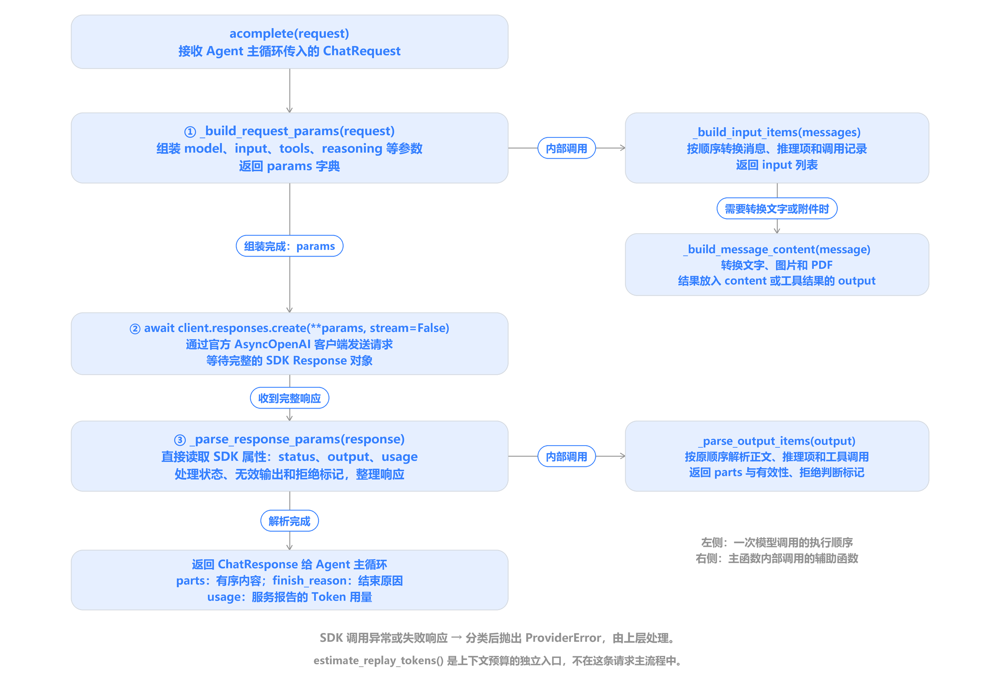

# Responses API

用户问「Windows 上也一样吗」，上下文模块已经把前面的对话、README 内容和这次提问整理成消息列表，Agent 主循环将它们装入 `ChatRequest`。`OpenAIResponsesProvider` 把内部消息和工具定义转换成 Responses API 参数，通过官方 `AsyncOpenAI` 客户端发送请求，等待完整的非流式响应。模型返回后，适配器直接读取 SDK 对象，将正文、推理项和工具调用按原顺序保存为 `MessagePart`，组成 `ChatResponse` 交回主循环。如果模型要求继续查看配置文件，主循环再保存调用、执行工具，并带着结果发起下一轮请求。

## 对象与字段

| 对象 | 关键字段 | 在本篇中的作用 |
| --- | --- | --- |
| `OpenAIResponsesProvider` | `_model`：模型名称；`_base_url`：服务地址；`_capabilities`：能力配置 | 将内部请求转换为 API 参数，通过官方 SDK 调用模型，再解析响应。 |
| `ChatRequest` | `messages`：消息列表；`tools`：工具定义；`tool_choice`：工具选择方式；`reasoning_effort`：推理强度 | 主循环交给适配器的一轮请求。 |
| `ChatResponse` | `provider`、`model`：响应来源；`parts`：有序输出部分；`finish_reason`：结束原因；`usage`：Token 用量 | 适配器解析后交回主循环的数据。正文和工具调用通过读取属性从 `parts` 提取。 |
| `ProviderError` | `kind`：错误类别；`message`：错误说明 | 将 SDK 调用错误或 API 失败响应统一交给上层处理。 |

`messages` 和 `parts` 的内部结构见 [03 会话历史](03-session-history.md)和 [04 上下文组装与压缩](04-context.md)。本篇只讲它们怎样与 API 输入、输出对应，不展开工具执行。

## 关键函数

| 函数 | 输入与输出 | 作用 |
| --- | --- | --- |
| [acomplete()](../raccoon/integrations/providers/openai_responses.py#L87) | `ChatRequest` → `ChatResponse` | 总入口：构建参数、创建 SDK 客户端、等待完整响应、解析结果。 |
| [_build_request_params()](../raccoon/integrations/providers/openai_responses.py#L107) | `ChatRequest` → 参数字典 | 组装 `model`、`input`、`tools`、`reasoning` 等 API 参数和固定设置。 |
| [_build_input_items()](../raccoon/integrations/providers/openai_responses.py#L139) | 消息列表 → API `input` 列表 | 按顺序转换正文、推理项、工具调用和工具结果。 |
| [_build_message_content()](../raccoon/integrations/providers/openai_responses.py#L316) | 一条消息 → 字符串或内容列表 | 转换用户、系统或工具结果中的文字、图片和 PDF。 |
| [_parse_response_params()](../raccoon/integrations/providers/openai_responses.py#L201) | SDK `Response` → `ChatResponse` | 直接读取响应状态、输出和用量，处理失败、不完整响应及无效输出。 |
| [_parse_output_items()](../raccoon/integrations/providers/openai_responses.py#L249) | SDK 输出项列表 → 有序 `parts` 和判断标记 | 解析正文、推理项与工具调用，保留必要协议字段，检查调用是否完整有效。 |
| [classify_provider_exception()](../raccoon/integrations/providers/errors.py#L9) | SDK 异常 → 错误类别 | 判断连接失败、超时、HTTP 错误等情况。 |
| [classify_response_error()](../raccoon/integrations/providers/errors.py#L34) | API 错误码 → 错误类别 | 将服务错误码转换为项目的错误分类。 |
| [token_usage()](../raccoon/integrations/providers/response_helpers.py#L7) | 输入、输出和总用量 → `TokenUsage` 或空值 | 整理服务返回的用量字段。 |
| [estimate_replay_tokens()](../raccoon/integrations/providers/openai_responses.py#L71) | 本轮消息列表 → Token 估算值 | 为上下文模块估算加密推理回放的额外占用，是独立入口。 |

## 主调用关系



```text
acomplete(request)
├── _build_request_params(request)
│   └── _build_input_items(request.messages)
│       └── _build_message_content(message)
├── await client.responses.create(**params, stream=False)
└── _parse_response_params(response)
    └── _parse_output_items(response.output)
```

`_build_message_content()` 只在需要转换用户、系统或工具结果中的文字和附件时调用。错误分类函数分别用于 SDK 抛出异常和 API 返回失败响应的情况；`token_usage()` 在响应解析时整理用量。`estimate_replay_tokens()` 由上下文预算调用，不属于上面这条主流程。

## 设计思路

1. **用官方 SDK，等完整结果再处理。** `await` 让等待模型时不阻塞其他工作，`stream=False` 表示拿到完整响应后再解析。当前先不处理流式片段，调用过程更容易理解。

2. **适配器负责转换格式。** 发送前把 `ChatRequest` 转成 OpenAI 接受的参数，返回后把 SDK 响应整理成 `ChatResponse`。主循环只关心模型说了什么、要调用什么工具。

3. **加密推理内容原样保存、原样带回。** 它不是正文，程序不解密，也不拿它生成摘要。来源服务和模型匹配时，下一轮随历史一起发送。成功压缩后，旧推理项全部停止发送，新产生的再重新记录。

4. **正文、推理和工具调用只保存一份。** 它们按模型返回的顺序放进 `parts`。需要显示回答或执行工具时，再从中读取；消息阶段和调用 ID 等必要字段也一起保留。

5. **出错就明确处理，不执行残缺的调用。** 网络或服务错误通过 `ProviderError` 交给上层。响应不完整、参数错误或调用 ID 重复时，丢弃工具调用，避免程序执行无法确认的操作。

## 源码入口

- [请求与响应](../raccoon/runtime/model_types.py)：`ChatRequest`、`ChatResponse` 及其使用的数据结构。
- [模型适配器](../raccoon/integrations/providers/openai_responses.py)：请求参数组装、官方 SDK 调用和响应解析。
- [错误分类](../raccoon/integrations/providers/errors.py)：SDK 异常和 API 错误码的分类规则。
- [项目错误类型](../raccoon/runtime/model_errors.py)：`ProviderError` 的类别与说明。

[返回模块指南](../README.md#模块指南)
