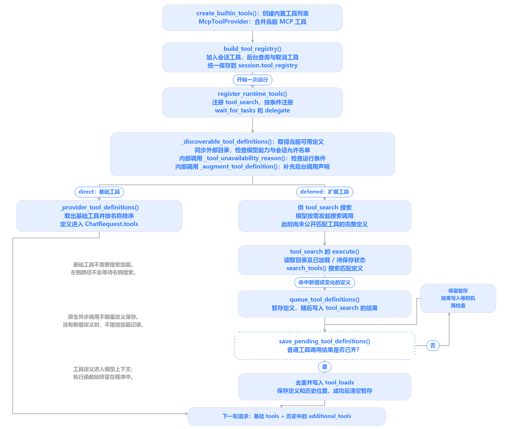

# 工具注册与发现

模型想查看代码改动，需要先知道有哪些工具可以使用。程序将内置工具、会话工具和已连接的 MCP 工具注册到会话工具目录中，每个工具都包含定义和执行函数。请求模型前，程序根据模型能力和当前运行配置筛选可用工具：基础工具直接提供完整定义，扩展工具则由模型通过 `tool_search` 按需搜索。搜索命中后，程序保存工具加载记录，在下一轮请求中提供名称、描述和参数格式，让模型能够调用新工具。具体的权限检查、工具执行和结果回写在后续章节展开。

## 对象与字段

| 对象 | 关键字段 | 在本篇中的作用 |
| --- | --- | --- |
| `ToolDefinition` | `name`：名称；`description`：说明；`parameters`：参数格式；`async_execution`：原生异步声明 | 给模型看的完整工具定义，不包含执行函数。 |
| `Tool` | `definition: ToolDefinition`；`executor`：执行函数；`exposure`：披露方式；`supports_background`：是否允许后台；`permission`：权限声明 | 程序中的完整工具，将模型看到的定义与实际执行函数放在一起。权限细节见 07。 |
| `ToolRegistry` | `_tools`：名称到 `Tool` 的映射；`_supplied_names`：外部传入工具的名称集合 | 保存工具目录。刷新外部工具时，区分哪些可以替换、哪些是需要保留的会话专属工具。 |
| `AgentSession` | `tool_registry: ToolRegistry`；`allowed_tool_names`：会话允许名单；`pending_tool_definitions`：待保存的定义列表；`data: SessionData` | 持有本会话工具目录和加载状态，组织加载记录的保存。 |
| `SessionData` | `tool_loads`：加载记录列表，每条包含 `definitions` 和 `after_message_id` | 保存历次加载的完整定义及其历史位置，用于恢复和上下文组装。 |
| `AgentRun` | `session: AgentSession`；`provider`：当前模型服务；`runtime_capabilities`：运行能力配置；`tools_provider`：外部目录获取入口；`native_async_tools`：是否启用原生异步 | 根据当前模型和运行条件筛选工具，并生成适用的后台调用声明。 |

`Tool.exposure` 决定如何向模型提供定义：

| 值 | 含义 |
| --- | --- |
| `direct` | 通过可用性筛选后，直接向模型提供完整定义。 |
| `deferred` | 已注册，但完整定义通过 `tool_search` 搜索加载后再提供。 |

这些对象的包含关系如下：

```text
AgentRun
└── session: AgentSession
    ├── tool_registry: ToolRegistry
    │   └── _tools[工具名称]: Tool
    │       ├── definition: ToolDefinition
    │       └── executor: 执行函数
    │
    ├── pending_tool_definitions: 待保存的 ToolDefinition 列表
    │
    └── data: SessionData
        └── tool_loads: 已保存的加载记录列表
            ├── definitions: 工具定义的序列化数据
            └── after_message_id: 加载声明对应的历史位置
```

`tool_loads` 保存 `tool_search` 命中后新增或更新加载的工具定义，不包含执行函数或工具执行结果。它是 JSONL 加载事件还原到内存后的数据，不是另一份独立日志。`definitions` 决定向模型提供什么，`after_message_id` 决定放在哪条消息之后；每次加载分别记录位置，而不是只保留最近一次。

基础工具定义进入 `ChatRequest.tools`；已加载的扩展定义按历史位置进入 `ChatMessage.additional_tools`。这两个对象的 API 转换过程见 [05 Responses API](05-responses-api.md)，本篇不重复展开。

`supports_background` 表示程序允许工具后台执行；`async_execution` 表示本次提供给模型的定义允许原生异步调用。前者是工具的程序侧能力，后者是根据运行配置生成的模型侧声明。

## 关键函数

### 创建与注册工具

| 函数 | 输入与输出 | 作用 |
| --- | --- | --- |
| [create_builtin_tools()](../raccoon/modules/tools/builtin.py#L36) | 工作区、启用选项等 → `list[Tool]` | 创建启用的内置工具，绑定定义和执行函数。 |
| [build_tool_registry()](../raccoon/modules/tools/session_registry.py#L23) | 工具列表、会话数据、存储和后台服务等 → `ToolRegistry` | 组装会话工具目录，加入会话专属工具及后台查询、取消工具。 |
| [register_runtime_tools()](../raccoon/bootstrap/tools.py#L9) | 当前 `AgentRun` → 更新会话注册表 | 处理 `tool_search`、`wait_for_tasks`、`delegate` 的运行期注册。 |
| [ToolRegistry.register()](../raccoon/modules/tools/registry.py#L23) | 一个 `Tool` → 写入注册表 | 检查重复名称、执行入口和参数 Schema，然后保存工具。 |
| [ToolRegistry.replace_supplied_tools()](../raccoon/modules/tools/registry.py#L41) | 最新外部工具列表 → 更新注册表 | 替换外部传入的那批工具，移除不再提供的工具，保留会话专属工具。 |

注册表示程序已经拥有工具的定义和执行函数，不代表模型已经看到了它。外部传入工具包括内置工具和 MCP 工具，不只是远程工具。

### 筛选与准备工具定义

下面是内部调用关系，不是四个函数依次执行：

```text
_provider_tool_definitions()
└── _discoverable_tool_definitions()
    ├── _tool_unavailability_reason()
    └── _augment_tool_definition()
```

| 函数 | 输入与输出 | 作用 |
| --- | --- | --- |
| [_provider_tool_definitions()](../raccoon/modules/agent/run.py#L635) | 当前可用目录 → 基础工具定义列表 | 取出 `direct` 工具，按名称排序，交给 `ChatRequest.tools`。 |
| [_discoverable_tool_definitions()](../raccoon/modules/agent/run.py#L644) | 当前目录和运行状态 → 可用定义列表 | 按现有机制同步外部工具目录，检查模型工具能力和会话允许名单，再判断运行条件、补充后台调用声明。 |
| [_tool_unavailability_reason()](../raccoon/modules/agent/run.py#L703) | 工具名称 → 不可用原因或 `None` | 判断视觉、用户交互、计划、子 Agent 等运行条件是否允许使用该工具。 |
| [_augment_tool_definition()](../raccoon/modules/agent/run.py#L660) | 原定义 → 适合当前运行的定义 | 根据 `supports_background` 和运行配置，补充原生异步声明或兼容后台参数；不修改注册表中的原定义。 |

`_discoverable_tool_definitions()` 返回当前可用的基础和扩展工具定义。`_provider_tool_definitions()` 从中取出基础工具，直接交给模型；`tool_search` 则从中取出扩展工具进行搜索。例如 `view` 和 `web_search` 都通过筛选，但只有标记为 `direct` 的工具进入基础列表，标记为 `deferred` 的工具仍需搜索加载。

### 搜索与加载工具

| 函数 | 输入与输出 | 作用 |
| --- | --- | --- |
| [create_tool_search()](../raccoon/modules/tools/search/discovery.py#L35) | 目录查询、加载状态查询和暂存回调 → `Tool` | 创建 `tool_search`，绑定负责搜索和暂存新定义的执行函数。 |
| [search_tools()](../raccoon/modules/tools/search/discovery.py#L23) | 工具定义列表、搜索词 → 匹配定义列表 | 根据名称、描述等信息搜索工具。 |
| [loaded_tool_definitions()](../raccoon/modules/agent/session.py#L203) | 会话 `tool_loads` → 名称到定义的映射 | 还原已保存的加载状态，同名工具取最新定义。 |
| [queue_tool_definitions()](../raccoon/modules/agent/session.py#L211) | 待加载定义 → 更新暂存列表 | 暂存允许加载的定义，等待合适的保存时机。 |
| [save_pending_tool_definitions()](../raccoon/modules/agent/session.py#L217) | 暂存列表和会话历史 → 按条件保存加载记录 | 普通调用结果齐全后，去重并写入历史，成功后清空暂存；原生异步调用不阻塞保存。 |

`create_tool_search()` 负责创建工具。模型调用 `tool_search` 时，运行的是它绑定的 `execute()`，不是再次创建工具。搜索时会同时考虑已保存和待保存的定义，避免重复加载未变化的工具。

```text
模型调用 tool_search
    ↓
读取可搜索目录和已加载状态
    ↓
search_tools() 搜索
    ↓ 命中新增或变化的定义
queue_tool_definitions() 暂存
    ↓
普通调用结果齐全后
save_pending_tool_definitions() 保存加载记录
    ↓
下一轮通过 additional_tools 提供给模型
```

模型调用扩展工具时，[_validate_tool_call()](../raccoon/modules/agent/run.py#L685) 会确认它已加载，且定义仍与当前目录一致。它还承担授权、异步能力和参数检查；具体权限及执行过程见 [07 工具权限](07-permissions.md)和 [08 工具执行与结果回写](08-tool-execution.md)。

## 流程图

图中箭头表示工具从注册到公开的处理过程；框内标明内部调用的辅助函数。基础工具直接进入请求，右侧只展开扩展工具首次加载或定义变化时的流程。



搜索时暂存的是工具定义，搜索结果仍按普通工具结果写入历史。`save_pending_tool_definitions()` 等普通调用结果齐全后再保存加载记录，原生异步调用不阻塞这一步。后续请求根据加载记录还原附加工具声明，不需要每次重新搜索。

## 设计思路

1. **注册工具和告诉模型分开。** 程序先保存工具定义和执行函数。基础工具直接提供给模型，扩展工具通过 `tool_search` 按需加载，避免一开始就放入大量暂时用不到的定义。

2. **工具是否可用，由当前运行决定。** 工具已注册，不代表每次都能使用。模型能力、会话允许名单和运行模式共同决定可用范围；后台能力由工具自身标记，实际执行仍需检查权限和运行条件。

3. **先保存搜索结果，再保存新工具声明。** 搜索命中后先暂存定义，等普通工具调用结果齐全，再去重并保存加载记录，避免把新声明插在调用与结果之间。原生异步调用不阻塞保存，写入失败时保留暂存。

4. **保存定义，也保存它出现的位置。** 加载记录包含完整定义和历史位置，恢复会话时可以重新组装。压缩旧对话时，旧位置上的工具定义会合并保留，同名工具取最新定义，避免模型因压缩而丢失准确的调用格式。

## 源码入口

- [内置工具创建](../raccoon/modules/tools/builtin.py)：`create_builtin_tools()` 创建工具并返回列表。
- [会话目录组装](../raccoon/modules/tools/session_registry.py)：`build_tool_registry()` 将传入工具和会话专属工具加入同一个注册表。

- [工具对象](../raccoon/modules/tools/types.py)：`Tool` 保存工具的执行入口和参数信息。
- [注册与声明](../raccoon/modules/tools/registry.py)：`ToolRegistry.register()` 注册工具，`definitions()` 列出对应的 `ToolDefinition`。
- [可见范围](../raccoon/modules/agent/run.py)：`_discoverable_tool_definitions()` 筛选本次运行可发现的工具，`_validate_tool_call()` 检查延迟加载的工具是否已经加载。

[返回模块指南](../README.md#模块指南)
